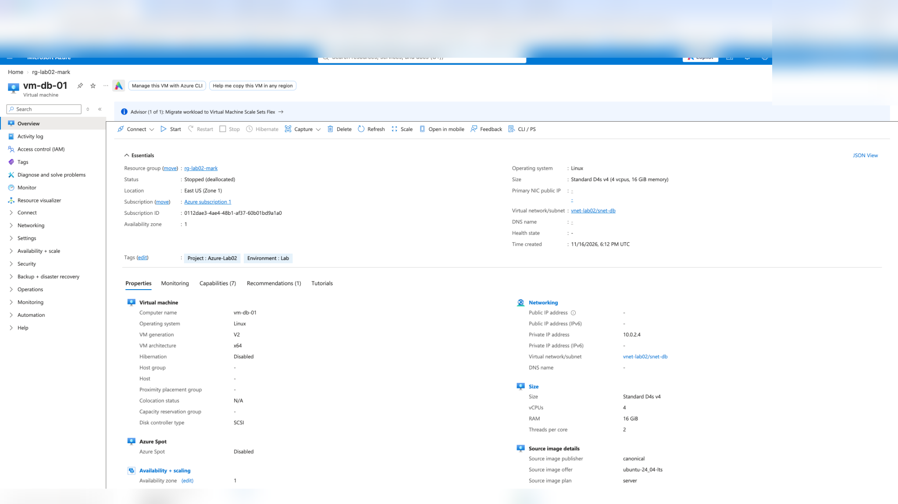
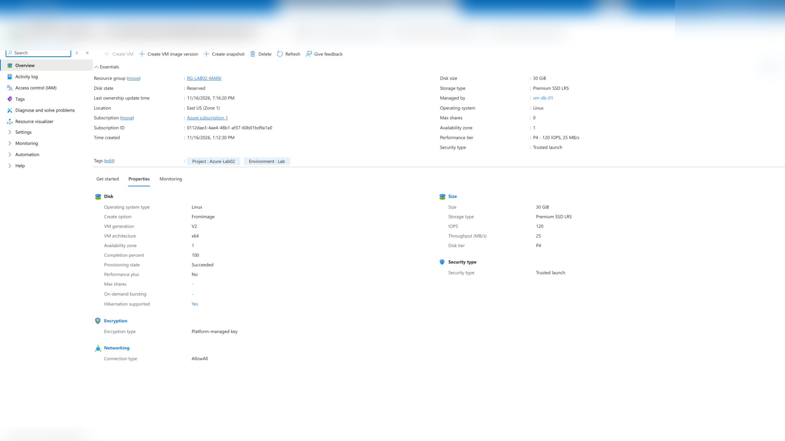
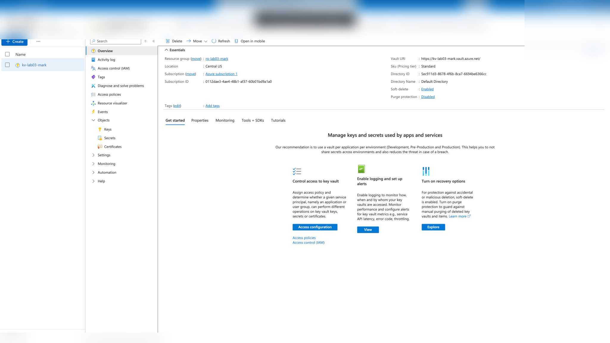
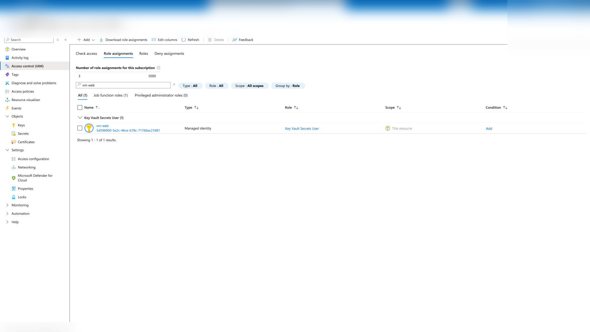
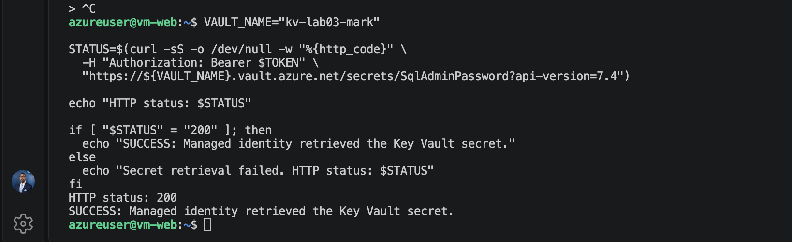
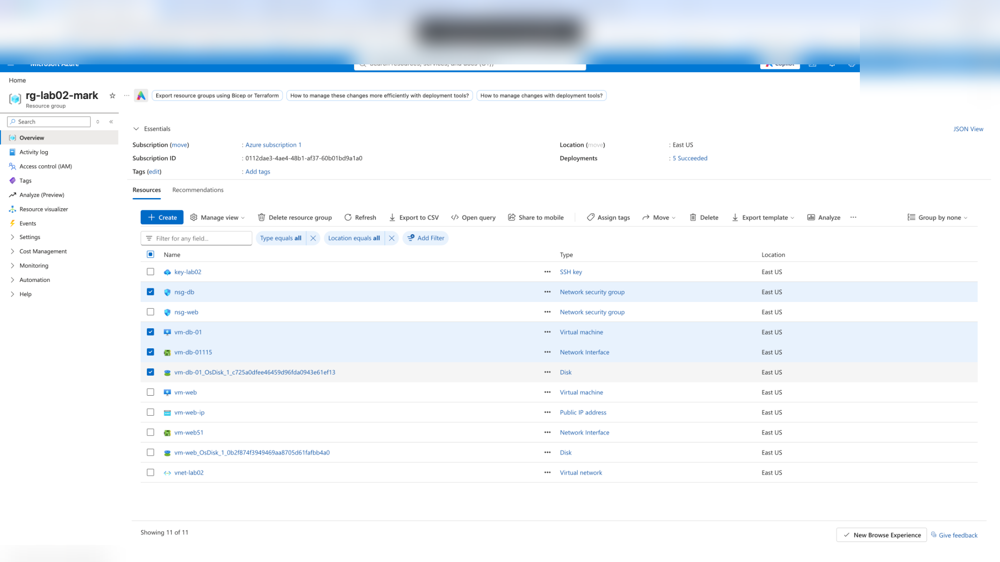

# Azure PaaS Modernization & Secure Secret Management

**Created and implemented by Mark Culberson**  
**Cloud Engineering • Microsoft Azure • Identity & Access Management • Secrets Security**

## Project objective

Modernize an existing two-tier Azure environment by retiring the self-managed database-tier virtual machine, provisioning a managed Azure SQL Database, and securing the SQL administrator credential in Azure Key Vault. Enable a system-assigned managed identity on the retained Ubuntu web VM, authorize that identity with Azure role-based access control (RBAC), and validate secret retrieval without exposing the credential.

## Implemented environment

| Component | Deployment / configuration |
|---|---|
| Existing web VM | `vm-web`, Ubuntu, retained in `rg-lab02-mark` |
| Existing network | `vnet-lab02`, web subnet and web NSG retained |
| Former DB-tier VM | `vm-db-01` and its DB-specific NIC, OS disk and NSG removed |
| PaaS resource group | `rg-lab03-mark` |
| Azure SQL Database | `sql-app` — online, Basic service tier (5 DTUs) |
| SQL logical server | `sql-server-markk` |
| Azure Key Vault | `kv-lab03-mark` — Standard tier, Central US |
| Secret | `SqlAdminPassword` — enabled; value not published |
| VM identity | System-assigned managed identity enabled on `vm-web` |
| Key Vault authorization | `Key Vault Secrets User` role assigned to `vm-web` managed identity at vault scope |
| Verification | Key Vault REST request returned **HTTP 200** using a bearer token acquired via managed identity |

## Architecture overview

The web tier continues to use the existing VM and network from the previous network project. The former database-tier VM has been removed, and Azure SQL Database now provides the managed database platform. Azure Key Vault stores the SQL administrator credential, while Microsoft Entra ID issues the managed identity token used to request the secret. Azure RBAC limits secret access to the authorized VM identity.

**Verified secret-access sequence:**

1. Enable the system-assigned identity on `vm-web`.
2. Grant that identity the `Key Vault Secrets User` role on `kv-lab03-mark`.
3. Acquire a token for Azure Key Vault using the VM's managed identity.
4. Send an authenticated request for the `SqlAdminPassword` secret to the Key Vault REST API.
5. Validate an **HTTP 200** response while suppressing the response body to prevent credential disclosure.

## Security design

- **Credential isolation:** The SQL password is stored as a Key Vault secret instead of being embedded in a repository or script.
- **Workload identity:** The VM uses its system-assigned managed identity to authenticate to Azure Key Vault without storing a separate Key Vault credential.
- **Least-privilege access:** The identity has the built-in `Key Vault Secrets User` role scoped to the vault.
- **Secret-safe verification:** The HTTP status code is captured without printing the secret value.
- **Recovery:** Key Vault soft-delete is enabled; purge protection was disabled in the observed project configuration.

## Challenges and problem-solving

Migrating from a self-managed database-tier VM to Azure SQL Database required carefully removing DB-specific infrastructure while preserving the existing web VM and VNet. I also had to distinguish enabling a managed identity from actually authorizing it to read secrets. My verification initially involved malformed shell commands and an unfinished terminal prompt; after correcting the request format, I received **HTTP 200** from the Key Vault REST API without printing the secret value. This reinforced the importance of careful CLI syntax, interpreting HTTP responses, and validating identity permissions rather than assuming that configuration alone proves access.

## What I learned

This project strengthened my understanding of the transition from IaaS to PaaS, how managed identities eliminate the need to store service credentials for Key Vault authentication, and how Azure RBAC controls access to sensitive application secrets. I also practiced validating access through an authenticated REST API request and documenting the outcome without disclosing secrets.

## Implementation evidence

The following screenshots document the Azure resources, security configurations, and validation steps completed during this project. Screenshots are presented as supporting evidence; a configuration or review screen does not, by itself, establish successful end-to-end application integration.

### 1. Azure SQL Database Deployment

I transitioned the database tier from a self-managed Ubuntu VM to **Azure SQL Database**, reducing the need to administer a database virtual machine. The deployed database `sql-app` was reported online on the Basic service tier (5 DTUs), with the logical server `sql-server-markk`.

*Azure SQL Database overview — database provisioning and service status.*

*SQL logical server — managed database server resource.*

### 2. Azure Key Vault & Secret Management

I provisioned **Azure Key Vault** (`kv-lab03-mark`) to store the SQL administrator credential as a secret instead of placing it in scripts or GitHub. The `SqlAdminPassword` secret was enabled; its value is intentionally not displayed.

*Key Vault overview — centralized secret-management resource.*

*Secret inventory — enabled secret name without exposing the secret value.*

### 3. Managed Identity & RBAC

I enabled a **system-assigned managed identity** on the retained Ubuntu web VM (`vm-web`) and configured vault-scoped **Key Vault Secrets User** access. This separates workload authentication from credential storage and demonstrates Azure role-based access control.

*Web VM identity settings — system-assigned managed identity configuration.*

*Key Vault authorization — RBAC configuration evidence. Consult the implementation and verification notes for the confirmed access outcome.*

### 4. Validation & Infrastructure Cleanup

To validate secret access, I acquired a token through the VM's managed identity and called the **Key Vault REST API**. The request returned **HTTP 200**, with the secret response body suppressed to avoid exposing the credential. I also removed the former database-tier VM and its DB-specific supporting resources while retaining the web tier.

*Validation — successful authenticated API response. The secret value is not shown.*

*Infrastructure cleanup — resource inventory following removal of DB-tier resources.*

**Scope of verification:** Azure SQL Database provisioning and managed-identity-based Key Vault secret retrieval were demonstrated. An application-to-Azure-SQL connection, SQL queries, and a deployed application backend were **not** verified in this project.

For configuration details and supporting notes, see [implementation](docs/implementation.md), [security and lessons learned](docs/security-and-lessons.md), and the [evidence guide](docs/evidence-guide.md).

## Skills demonstrated

Azure SQL Database · Azure Key Vault · Microsoft Entra ID · System-assigned Managed Identity · Azure RBAC · REST APIs · Linux CLI · cURL · HTTP Status Validation · IaaS-to-PaaS Modernization · Credential Security · Cloud Troubleshooting · Cost Awareness

## Future security enhancements

For a production deployment, evaluate private endpoints, restricted public network access, Microsoft Entra authentication for SQL, secret rotation, logging and alerting, and Key Vault purge protection. These are improvement ideas, not assertions about the project configuration.

## Cost management

The Basic SQL tier displayed an estimated **$4.90/month** in the Azure portal at the time of the project. Azure resources may incur costs while provisioned; review Cost Management and delete resources only when they are no longer needed for subsequent projects.

---

**Author: Mark Culberson**
