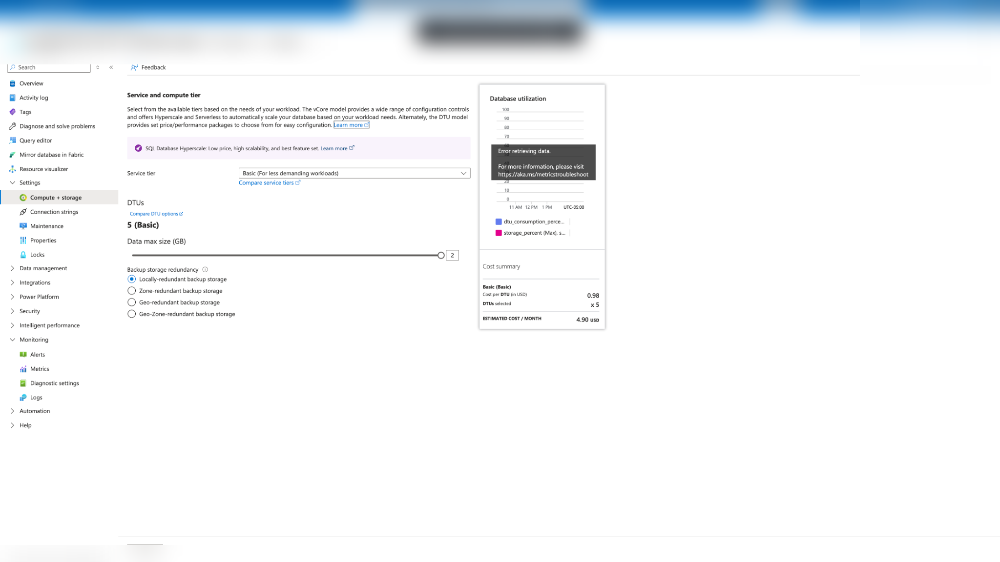
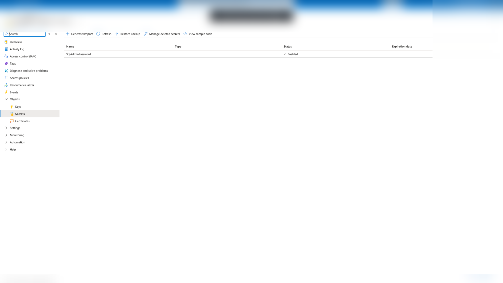

# Azure PaaS Modernization & Secure Secret Management

**Created and implemented by Mark Culberson**  
**Cloud Engineering • Microsoft Azure • Identity & Access Management • Secrets Security**

## Project objective

Modernize an existing two-tier Azure environment by retiring the self-managed database-tier virtual machine, provisioning a managed Azure SQL Database, and securing the SQL administrator credential in Azure Key Vault. Enable a system-assigned managed identity on the retained Ubuntu web VM, authorize that identity with Azure role-based access control (RBAC), and validate secret retrieval without exposing the credential.

## Implemented environment

| Component | Deployment / configuration |
|---|---|
| Existing web VM | `vm-web`, Ubuntu, retained in `rg-lab02-mark` |
| Existing network | `vnet-lab02`, web subnet and web NSG retained |
| Former DB-tier VM | `vm-db-01` and its DB-specific NIC, OS disk and NSG removed |
| PaaS resource group | `rg-lab03-mark` |
| Azure SQL Database | `sql-app` — online, Basic service tier (5 DTUs) |
| SQL logical server | `sql-server-markk` |
| Azure Key Vault | `kv-lab03-mark` — Standard tier, Central US |
| Secret | `SqlAdminPassword` — enabled; value not published |
| VM identity | System-assigned managed identity enabled on `vm-web` |
| Key Vault authorization | `Key Vault Secrets User` role assigned to `vm-web` managed identity at vault scope |
| Verification | Key Vault REST request returned **HTTP 200** using a bearer token acquired via managed identity |

## Architecture overview

The web tier continues to use the existing VM and network from the previous network project. The former database-tier VM has been removed, and Azure SQL Database now provides the managed database platform. Azure Key Vault stores the SQL administrator credential, while Microsoft Entra ID issues the managed identity token used to request the secret. Azure RBAC limits secret access to the authorized VM identity.

**Verified secret-access sequence:**

1. Enable the system-assigned identity on `vm-web`.
2. Grant that identity the `Key Vault Secrets User` role on `kv-lab03-mark`.
3. Acquire a token for Azure Key Vault using the VM's managed identity.
4. Send an authenticated request for the `SqlAdminPassword` secret to the Key Vault REST API.
5. Validate an **HTTP 200** response while suppressing the response body to prevent credential disclosure.

## Security design

- **Credential isolation:** The SQL password is stored as a Key Vault secret instead of being embedded in a repository or script.
- **Workload identity:** The VM uses its system-assigned managed identity to authenticate to Azure Key Vault without storing a separate Key Vault credential.
- **Least-privilege access:** The identity has the built-in `Key Vault Secrets User` role scoped to the vault.
- **Secret-safe verification:** The HTTP status code is captured without printing the secret value.
- **Recovery:** Key Vault soft-delete is enabled; purge protection was disabled in the observed project configuration.

## Challenges and problem-solving

Migrating from a self-managed database-tier VM to Azure SQL Database required carefully removing DB-specific infrastructure while preserving the existing web VM and VNet. I also had to distinguish enabling a managed identity from actually authorizing it to read secrets. My verification initially involved malformed shell commands and an unfinished terminal prompt; after correcting the request format, I received **HTTP 200** from the Key Vault REST API without printing the secret value. This reinforced the importance of careful CLI syntax, interpreting HTTP responses, and validating identity permissions rather than assuming that configuration alone proves access.

## What I learned

This project strengthened my understanding of the transition from IaaS to PaaS, how managed identities eliminate the need to store service credentials for Key Vault authentication, and how Azure RBAC controls access to sensitive application secrets. I also practiced validating access through an authenticated REST API request and documenting the outcome without disclosing secrets.

## Implementation evidence

This portfolio separates **resource configuration**, **authorization**, and **successful API validation**. Each caption describes the screen actually captured, rather than attributing unrelated evidence to a service.

### Azure infrastructure and database modernization

The original environment included a self-managed database-tier VM and managed disk. Those resources were subsequently retired as the database tier moved to Azure SQL Database. The earlier captures below show the **former IaaS resources**, not the Azure SQL service.

*Historical infrastructure: former database-tier virtual machine. This is **not** an Azure SQL Database overview.*

*Historical infrastructure: managed disk associated with the former database VM. This is **not** an Azure SQL logical server screenshot.*

The Azure SQL logical server `sql-server-markk` and its database `sql-app` (Online, Basic tier) are documented in the project inventory. A separate, correctly identified SQL logical server capture is being prepared for upload.

*Azure SQL Database compute/storage configuration; this capture does **not** show VM managed identity.*

### Azure Key Vault and secret management

The project uses `kv-lab03-mark` to hold the enabled `SqlAdminPassword` secret. The secret's value is intentionally excluded.

*Key Vault resource overview.*

*Secret list showing configuration, not the credential value.*

### Managed identity and role-based access control

The retained `vm-web` Ubuntu VM was configured with a system-assigned managed identity, and vault-scoped `Key Vault Secrets User` authorization was configured for that identity. A separate identity-status screenshot is being prepared for upload; the SQL compute screenshot above must not be used as identity evidence.

*Key Vault RBAC screen. A role-selection or review screen alone does not establish that an assignment was completed; the successful authenticated request below provides additional functional evidence of access.*

### API verification and resource inventory

The Key Vault REST request using a token acquired through managed identity returned **HTTP 200**. The response body was suppressed to avoid publishing the secret.

*Successful API status response; this verifies access to the requested Key Vault endpoint, not a SQL application connection.*

*Azure resource inventory captured during infrastructure review. The image is not, by itself, a before-and-after proof of DB-tier deletion.*

**Verification boundary:** This project documents Azure SQL provisioning and managed-identity-based Key Vault access. It does not claim an application-to-SQL connection, executed SQL queries, or a deployed application backend.

**Evidence maintenance:** Two additional original captures—`sql-server-markk` overview and `vm-web` identity status—are available for upload under descriptive filenames. The older historical filenames are retained temporarily to avoid broken links; the captions above explicitly identify their actual contents.

For technical context, see [implementation](docs/implementation.md), [security and lessons](docs/security-and-lessons.md), and the [evidence guide](docs/evidence-guide.md).

## Skills demonstrated

Azure SQL Database · Azure Key Vault · Microsoft Entra ID · System-assigned Managed Identity · Azure RBAC · REST APIs · Linux CLI · cURL · HTTP Status Validation · IaaS-to-PaaS Modernization · Credential Security · Cloud Troubleshooting · Cost Awareness

## Future security enhancements

For a production deployment, evaluate private endpoints, restricted public network access, Microsoft Entra authentication for SQL, secret rotation, logging and alerting, and Key Vault purge protection. These are improvement ideas, not assertions about the project configuration.

## Cost management

The Basic SQL tier displayed an estimated **$4.90/month** in the Azure portal at the time of the project. Azure resources may incur costs while provisioned; review Cost Management and delete resources only when they are no longer needed for subsequent projects.

---

**Author: Mark Culberson**
