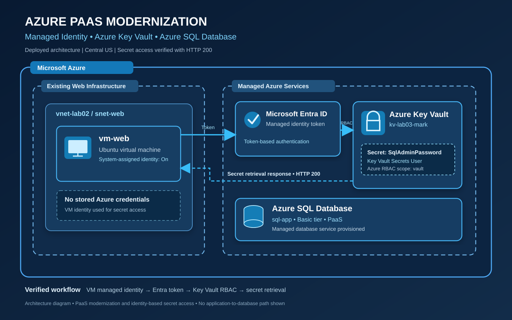

# Azure PaaS Modernization & Secure Secret Management

**Created and implemented by Mark Culberson**  
**Cloud Engineering • Microsoft Azure • Identity & Access Management • Secrets Security**

## Project objective

Modernize an existing two-tier Azure environment by retiring the self-managed database-tier virtual machine, provisioning a managed Azure SQL Database, and securing the SQL administrator credential in Azure Key Vault. Enable a system-assigned managed identity on the retained Ubuntu web VM, authorize that identity with Azure role-based access control (RBAC), and validate secret retrieval without exposing the credential.

## Implemented environment

| Component | Deployment / configuration |
|---|---|
| Existing web VM | `vm-web`, Ubuntu, retained in `rg-lab02-mark` |
| Existing network | `vnet-lab02`, web subnet and web NSG retained |
| Former DB-tier VM | `vm-db-01` and its DB-specific NIC, OS disk and NSG removed |
| PaaS resource group | `rg-lab03-mark` |
| Azure SQL Database | `sql-app` — online, Basic service tier (5 DTUs) |
| SQL logical server | `sql-server-markk` |
| Azure Key Vault | `kv-lab03-mark` — Standard tier, Central US |
| Secret | `SqlAdminPassword` — enabled; value not published |
| VM identity | System-assigned managed identity enabled on `vm-web` |
| Key Vault authorization | `Key Vault Secrets User` role assigned to `vm-web` managed identity at vault scope |
| Verification | Key Vault REST request returned **HTTP 200** using a bearer token acquired via managed identity |

## Architecture overview

The web tier continues to use the existing VM and network from the previous network project. The former database-tier VM has been removed, and Azure SQL Database now provides the managed database platform. Azure Key Vault stores the SQL administrator credential, while Microsoft Entra ID issues the managed identity token used to request the secret. Azure RBAC limits secret access to the authorized VM identity.

**Verified secret-access sequence:**

1. Enable the system-assigned identity on `vm-web`.
2. Grant that identity the `Key Vault Secrets User` role on `kv-lab03-mark`.
3. Acquire a token for Azure Key Vault using the VM's managed identity.
4. Send an authenticated request for the `SqlAdminPassword` secret to the Key Vault REST API.
5. Validate an **HTTP 200** response while suppressing the response body to prevent credential disclosure.

## Security design

- **Credential isolation:** The SQL password is stored as a Key Vault secret instead of being embedded in a repository or script.
- **Workload identity:** The VM uses its system-assigned managed identity to authenticate to Azure Key Vault without storing a separate Key Vault credential.
- **Least-privilege access:** The identity has the built-in `Key Vault Secrets User` role scoped to the vault.
- **Secret-safe verification:** The HTTP status code is captured without printing the secret value.
- **Recovery:** Key Vault soft-delete is enabled; purge protection was disabled in the observed project configuration.

## Challenges and problem-solving

Migrating from a self-managed database-tier VM to Azure SQL Database required carefully removing DB-specific infrastructure while preserving the existing web VM and VNet. I also had to distinguish enabling a managed identity from actually authorizing it to read secrets. My verification initially involved malformed shell commands and an unfinished terminal prompt; after correcting the request format, I received **HTTP 200** from the Key Vault REST API without printing the secret value. This reinforced the importance of careful CLI syntax, interpreting HTTP responses, and validating identity permissions rather than assuming that configuration alone proves access.

## What I learned

This project strengthened my understanding of the transition from IaaS to PaaS, how managed identities eliminate the need to store service credentials for Key Vault authentication, and how Azure RBAC controls access to sensitive application secrets. I also practiced validating access through an authenticated REST API request and documenting the outcome without disclosing secrets.

## Implementation evidence

This portfolio separates **resource configuration**, **authorization**, and **successful API validation**. Each caption describes the screen actually captured, rather than attributing unrelated evidence to a service.

### Azure infrastructure and database modernization

This project explores an **IaaS-to-PaaS database modernization approach**: documenting an earlier Linux VM-based database tier and provisioning a managed Azure SQL Database. The original VM and disk belonged to `rg-lab02-mark`, while the new Azure SQL resources were provisioned in `rg-lab03-mark`. The historical captures establish the original configuration, but **do not independently prove deletion of the old resources**.

#### Former database-tier infrastructure

*Historical Azure VM `vm-db-01` in a stopped (deallocated) state, with 4 vCPUs, 16 GiB RAM, and private IP `10.0.2.4`. This is an IaaS VM, not Azure SQL Database.*

*Historical 30 GiB Premium SSD LRS managed OS disk associated with `vm-db-01`.*

#### Azure SQL Database provisioning

I provisioned Azure SQL logical server `sql-server-markk` in **Central US**, with the managed database `sql-app`.

*SQL logical server `sql-server-markk` showing Available status and the associated `sql-app` database.*

*Azure SQL Database `sql-app` showing Online status and the Basic pricing tier.*

*Azure SQL Basic service tier configured for 5 DTUs, a 2 GB maximum database size, and locally redundant backup storage.*

**Engineering takeaway:** Azure SQL Database reduces the operating-system and database-server infrastructure administration associated with a self-managed VM. Database access, networking, and security configuration still require deliberate management.

### Azure Key Vault and secret management

To avoid embedding a SQL administrator credential in source code, I deployed Azure Key Vault `kv-lab03-mark` in **Central US** and created an enabled secret named `SqlAdminPassword`.

*Key Vault `kv-lab03-mark` overview, including the vault endpoint and enabled soft delete. Purge protection was disabled in the captured configuration.*

*Secret inventory showing `SqlAdminPassword` successfully created and enabled; the secret value is not displayed.*

**Security takeaway:** Centralized secret storage makes it possible to control credential access through Azure identity and authorization instead of distributing credentials across scripts or application configuration.

### Managed identity and role-based access control

I enabled a **system-assigned managed identity** for the existing Ubuntu VM `vm-web`. This allows the VM to request Microsoft Entra tokens without storing a client secret for its own Azure identity.

*Azure VM `vm-web` Identity page showing system-assigned identity Status: On and a provisioned principal ID.*

I then assigned the **Key Vault Secrets User** role to the `vm-web` managed identity at the scope of `kv-lab03-mark`.

*Key Vault Access control (IAM) → Role assignments showing `vm-web` as a managed identity with the `Key Vault Secrets User` role at This resource scope. This is a completed assignment listing, not merely the assignment wizard.*

**Security takeaway:** Managed identity plus vault-scoped RBAC enables secret access without a separately stored application credential and limits the identity's Key Vault permissions.

### API verification and resource inventory

#### Key Vault REST API verification

From `vm-web`, I tested an authenticated REST request to the `SqlAdminPassword` secret endpoint using a bearer token obtained through managed identity. The cURL request discarded the response body to avoid displaying the secret value.

*Terminal output shows `HTTP status: 200` and the success message after the Key Vault secret request. This verifies authenticated access to that endpoint, not connectivity to Azure SQL Database.*

#### Azure PaaS resource inventory

*Resource group `rg-lab03-mark` lists Key Vault `kv-lab03-mark`, SQL database `sql-app`, and SQL logical server `sql-server-markk`, all in Central US. The web VM is in the separate `rg-lab02-mark` resource group.*

**Verification boundary:** The evidence demonstrates Azure SQL provisioning, an enabled system-assigned VM identity, a completed vault-scoped RBAC assignment, and successful Key Vault REST API access. It does **not** demonstrate a deployed application backend, application-to-SQL connectivity, executed SQL queries, or independently verified deletion of the former database VM and disk.

**Evidence hygiene:** Review screenshots for subscription IDs, directory IDs, account information, and other sensitive identifiers before publishing. A before-and-after resource inventory or Azure activity log would be needed to document database-tier cleanup conclusively.

For further context, see [implementation](docs/implementation.md), [security and lessons](docs/security-and-lessons.md), and the [evidence guide](docs/evidence-guide.md).

## Skills demonstrated

Azure SQL Database · Azure Key Vault · Microsoft Entra ID · System-assigned Managed Identity · Azure RBAC · REST APIs · Linux CLI · cURL · HTTP Status Validation · IaaS-to-PaaS Modernization · Credential Security · Cloud Troubleshooting · Cost Awareness

## Future security enhancements

For a production deployment, evaluate private endpoints, restricted public network access, Microsoft Entra authentication for SQL, secret rotation, logging and alerting, and Key Vault purge protection. These are improvement ideas, not assertions about the project configuration.

## Cost management

The Basic SQL tier displayed an estimated **$4.90/month** in the Azure portal at the time of the project. Azure resources may incur costs while provisioned; review Cost Management and delete resources only when they are no longer needed for subsequent projects.

---

**Author: Mark Culberson**
